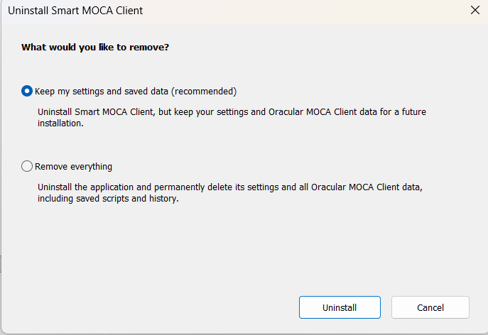

# EXE Uninstallation

## Overview

Use EXE uninstallation only for Smart MOCA Client installations that were installed with the EXE installer.

The EXE uninstaller is `unins000.exe` in the Smart MOCA Client installation folder.

## Prerequisites

- Use the same Windows account for a current-user installation.
- Use administrator rights for an all-users installation.
- Back up saved data before choosing complete removal.

## Uninstallation

### Default Uninstallation

```bat
"%APPDATA%\SmartMOCAClient\unins000.exe"
```

For an all-users installation, run the uninstaller from the all-users installation folder:

```bat
"%PROGRAMDATA%\SmartMOCAClient\unins000.exe"
```

The uninstaller asks whether to keep settings and saved data or remove everything.



### Silent Uninstallation

```bat
"%APPDATA%\SmartMOCAClient\unins000.exe" /VERYSILENT /SUPPRESSMSGBOXES /NORESTART
```

This silently removes application files and shortcuts, while keeping configuration and Oracular MOCA Client data.

Silently uninstall an all-users installation:

```bat
"%PROGRAMDATA%\SmartMOCAClient\unins000.exe" /VERYSILENT /SUPPRESSMSGBOXES /NORESTART
```

Silently remove everything:

```bat
"%APPDATA%\SmartMOCAClient\unins000.exe" /VERYSILENT /SUPPRESSMSGBOXES /NORESTART /REMOVEALL
```

Create an uninstallation log:

```bat
"%APPDATA%\SmartMOCAClient\unins000.exe" /VERYSILENT /SUPPRESSMSGBOXES /NORESTART /LOG="%TEMP%\smc-exe-uninstall.log"
```

## Uninstallation Options

| Option | Default | Description |
| --- | --- | --- |
| `/VERYSILENT` | Not used | Runs uninstall without wizard pages. |
| `/SUPPRESSMSGBOXES` | Not used | Suppresses message boxes during silent uninstall. |
| `/NORESTART` | Not used | Prevents automatic restart. |
| `/REMOVEALL` | Not used | Removes application files, settings, Oracular MOCA Client data, and Oracular Automated Testing data. Omit this option to keep saved data. |
| `/LOG="path"` | Not used | Writes an Inno Setup uninstall log file. |

Do not use `/CURRENTUSER`, `/ALLUSERS`, or `/SP-` with the EXE uninstaller. The uninstaller uses the installation folder it runs from, and `/SP-` applies to setup startup prompts only.

## Examples

Silent uninstall and keep saved data:

```bat
"%APPDATA%\SmartMOCAClient\unins000.exe" /VERYSILENT /SUPPRESSMSGBOXES /NORESTART
```

Silent all-users uninstall and remove all saved data:

```bat
"%PROGRAMDATA%\SmartMOCAClient\unins000.exe" /VERYSILENT /SUPPRESSMSGBOXES /NORESTART /REMOVEALL
```

## Related Pages

- [EXE Installation](./getting-started/exe-installation.md)
- [MSI Uninstallation](./getting-started/msi-uninstallation.md)
