# Current Version: Overview and Download

Smart MOCA Client is a Windows desktop client for connecting to MOCA environments, managing server connections, and working with MOCA tools.

Use this page to download the current version, choose the right installer, verify the installation, launch Smart MOCA Client, add a server, and download `moca.jar`.

## System Requirements

| Requirement | Minimum |
| --- | --- |
| Operating system | Windows 7 or later |
| Processor | Intel Core i3 or equivalent |
| Memory | 4 GB RAM |
| Storage | 500 MB available space |
| Java | Java SE 8 or later |

## Download Smart MOCA Client

1. Open the [Smart IS MOCA Client page](https://www.smart-is.com/what-we-do/smart-product/smart-is-moca-client/).

   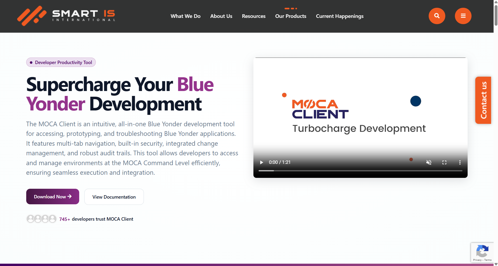

2. Select **Download Now** and complete the download request form.

   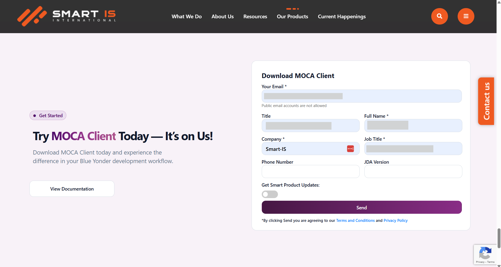

3. Open the email from Smart IS and select **Download MOCA Client**.

   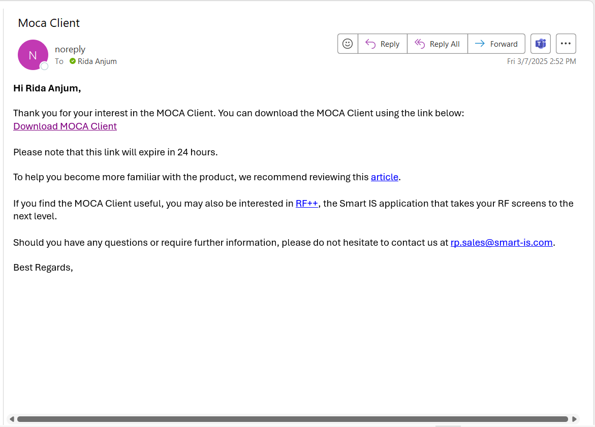

## Which Installer Should I Choose?

For most users, choose the **EXE installer**. It is the simplest option for a normal desktop installation.

Use the **MSI installer** when your IT team deploys software with Windows Installer tools or needs MSI command-line options.

Use **Portable** only when you need to extract and run the package without using a standard installer.

| Option | Best for | Administrator rights | Silent install |
| --- | --- | --- | --- |
| EXE installer | Individual users and normal desktop setup | Not needed for **Run as User**. Needed for **Run as Administrator**. | Yes |
| MSI installer | IT-managed deployment | Not needed for **Run as User**. Needed for **Run as Administrator**. | Yes |
| Portable | Extract-and-run use cases | Depends on where files are extracted | No standard installer command |

> **Note:** Use one installer type per computer. If Smart MOCA Client was installed with the EXE installer, uninstall it with the EXE uninstaller. If it was installed with the MSI installer, uninstall it with MSI.

## Download Options

### EXE Installer

1. On the download page, select **Installer**.
2. Select **Download**.

   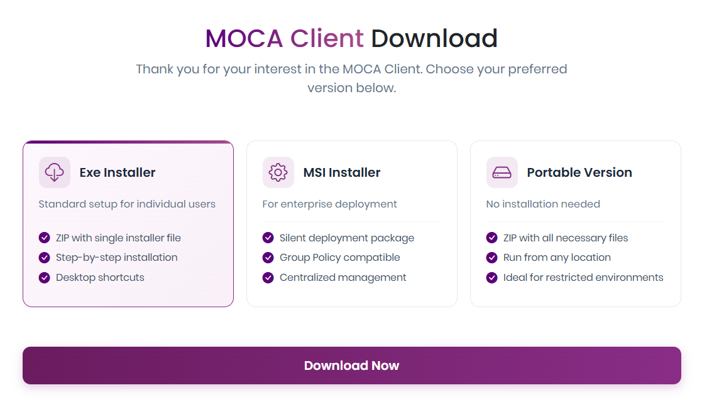

3. Follow [Install with the EXE installer](#/./getting-started/exe-installation).

### MSI Installer

1. On the download page, select **MSI Installer**.
2. Select **Download**.

   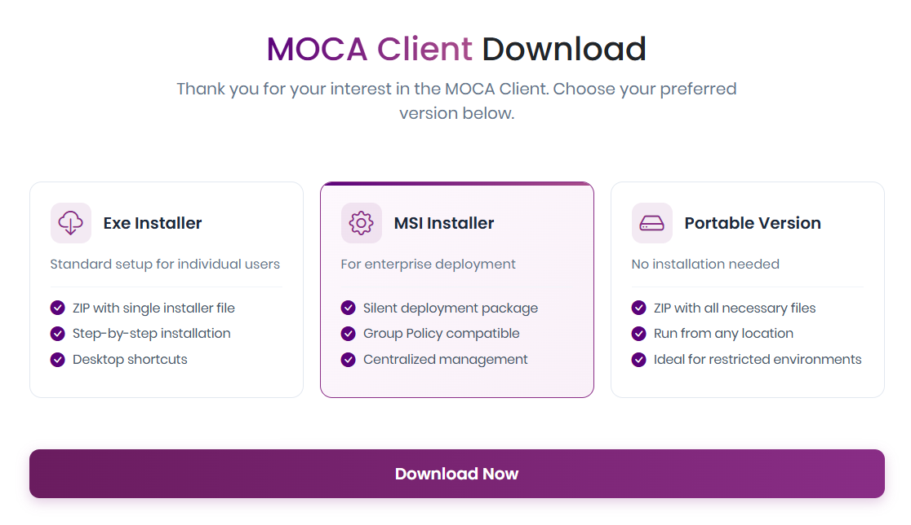

3. Follow [Install with the MSI installer](#/./getting-started/msi-installation).

### Portable

1. On the download page, select **Portable**.
2. Select **Download**.

   

3. Follow [Portable setup](#/./getting-started/portable).

## Verify Installation

1. Open the installation folder chosen during setup.
2. Confirm that the `SmartMOCAClient` folder exists.
3. Confirm that Smart MOCA Client shortcuts are available from the Start Menu or desktop.

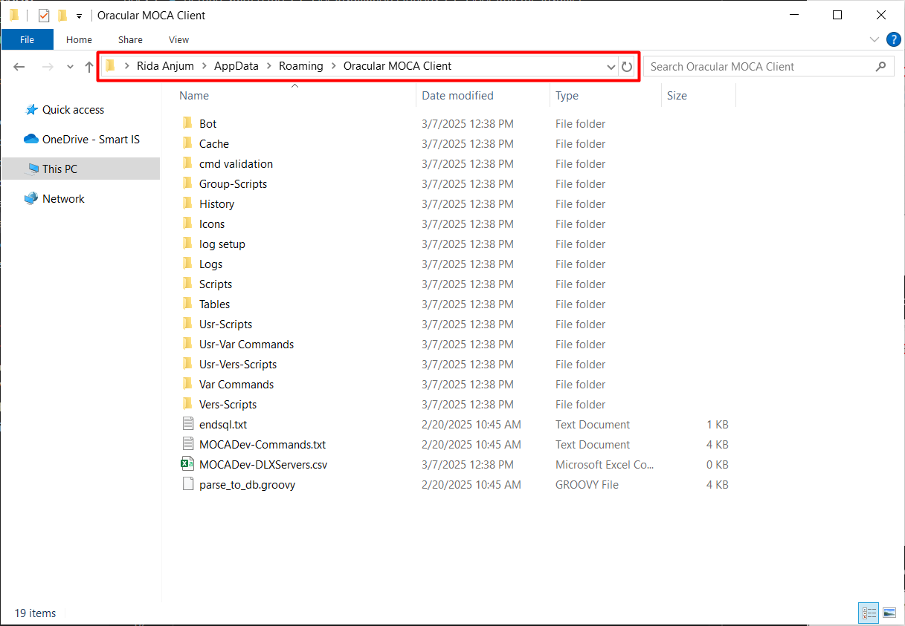

> **Tip:** If shortcuts are not created, open the application from the installation folder or ask your IT administrator to recreate the shortcut.

## Launch Smart MOCA Client

1. Open the Windows Start Menu.
2. Search for **Smart MOCA Client**.
3. Select **Smart MOCA Client**.

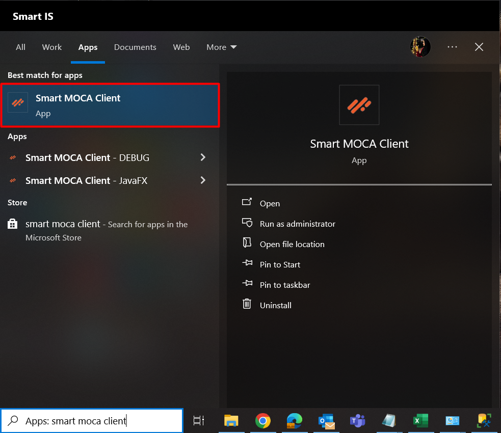

When the application starts, the Smart MOCA Client window appears.

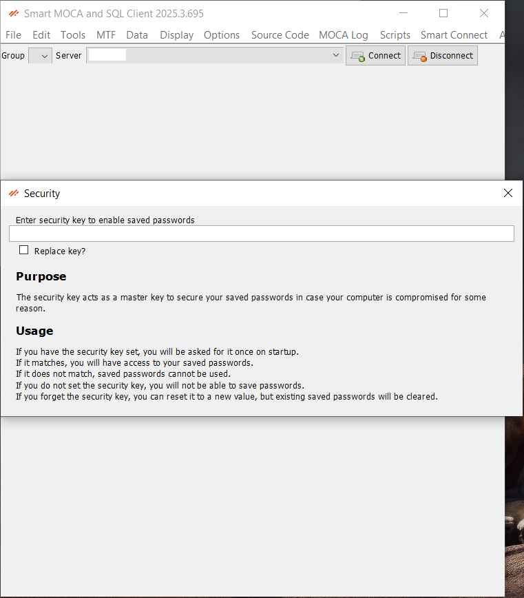

## Add a Server

After launching Smart MOCA Client, add a server connection before downloading `moca.jar` or running MOCA commands.

Follow [Add, update, or remove a server](../connections/add-connect-remoteserver.md).

## Download `moca.jar`

Smart MOCA Client can download `moca.jar` after you connect to a server.

### Download During First Server Connection

1. Connect to a server.
2. When Smart MOCA Client detects that `moca.jar` is missing, select **Download and Use the moca.jar from this environment**.

   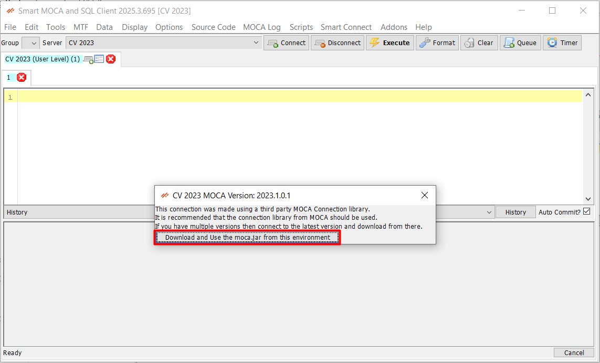

3. Wait for the download to finish.

   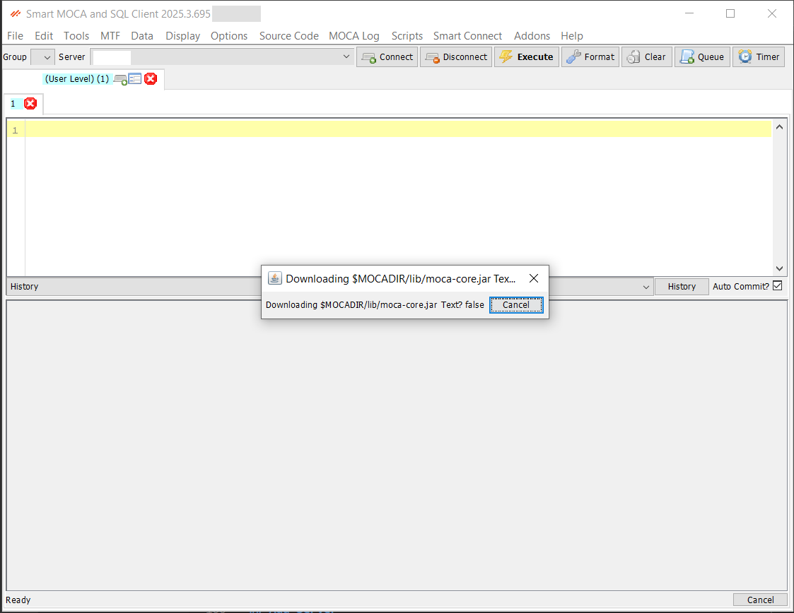

4. Restart Smart MOCA Client.
5. Confirm the application is using `moca.jar` from **Help > About Smart MOCA and SQL Client**.

   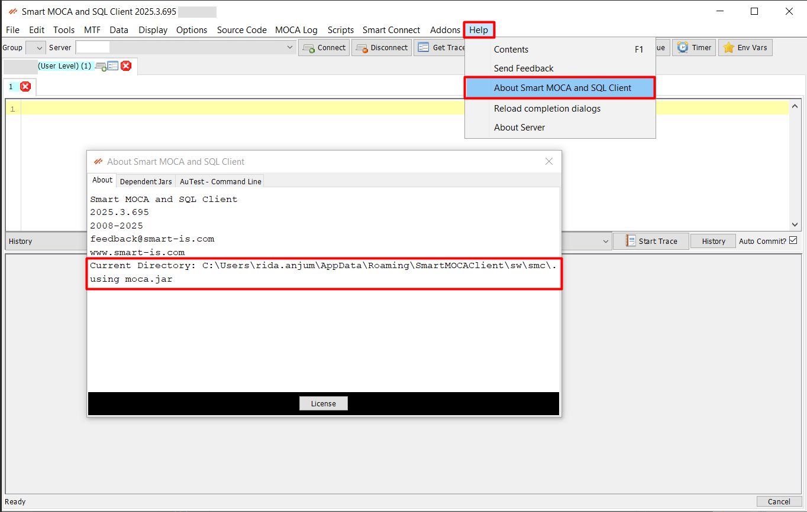

### Download from the Tools Menu

If you skipped the prompt during server connection, select **Tools > Download moca.jar**.

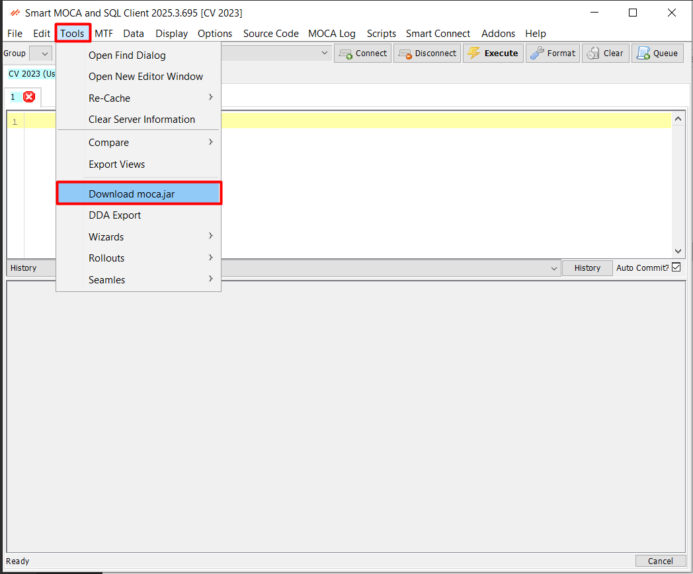

> **Note:** `moca.jar` must be compatible with the Java version used by Smart MOCA Client.

## Related Pages

- [Install with the EXE installer](#/./getting-started/exe-installation)
- [Silent install with EXE](#/./getting-started/exe-silent-installation)
- [Uninstall EXE](#/./getting-started/exe-uninstallation)
- [Install with the MSI installer](#/./getting-started/msi-installation)
- [Silent install with MSI](#/./getting-started/msi-silent-installation)
- [Uninstall MSI](#/./getting-started/msi-uninstallation)
- [Portable setup](#/./getting-started/portable)
- [Troubleshooting](#/./getting-started/troubleshooting)
