# Get Started with Smart MOCA Client - Current

Guide for connecting to a server using the latest MOCA Client interface.

## Download Smart MOCA Client
       
- Visit the [Smart IS](https://www.smart-is.com/what-we-do/smart-product/smart-is-moca-client/) website and navigate to **Our Products > MOCA Client.**
       
  

- Click the **Download Now** button and complete the form that appears with your information to download the latest version of the installer.

  

- After filling out the form, you will receive an email with a link to the download page.

  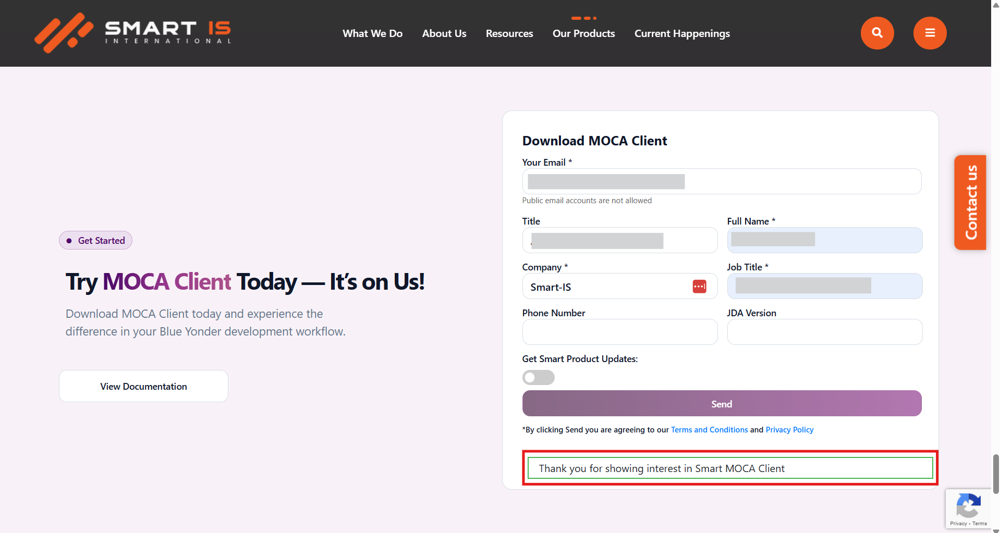

- Now open an email you received from Smart IS and Select the **Download MOCA Client** link provided in the email to navigate to the download page.

  

## Download Options
  
The download page provides these options:

1. EXE Installer
2. Portable
3. MSI Installer

Use one installer format for each installation. If Smart MOCA Client was installed with the EXE installer, uninstall it with the EXE uninstaller. If it was installed with the MSI installer, uninstall it with MSI.

## EXE Installer
  
- On the download page, select **Installer** and click on **Download** button.

  

- After clicking **"Download"**, the installation setup will begin downloading.

  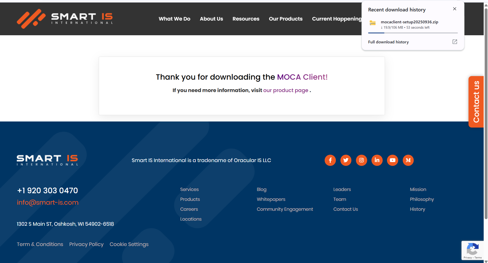

- Follow [EXE Installation](./exe-installation.md) to install Smart MOCA Client with the EXE installer.
- Follow [EXE Uninstallation](./exe-uninstallation.md) to remove an EXE installation.

---

## Portable

- On the download page, select **Portable** and click on **Download** button.

  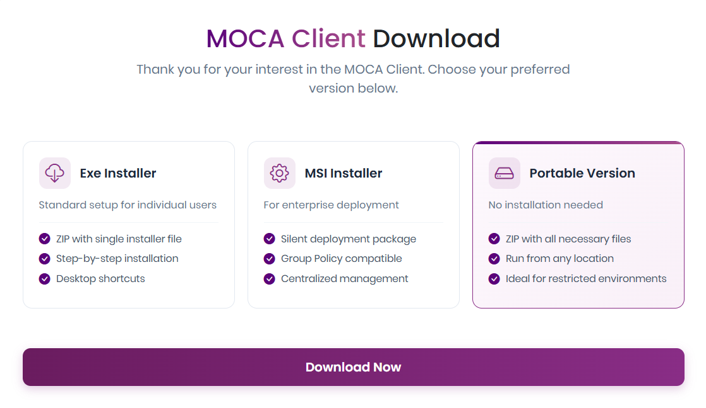

- After clicking **"Download"**, the portable setup will begin downloading.
  
  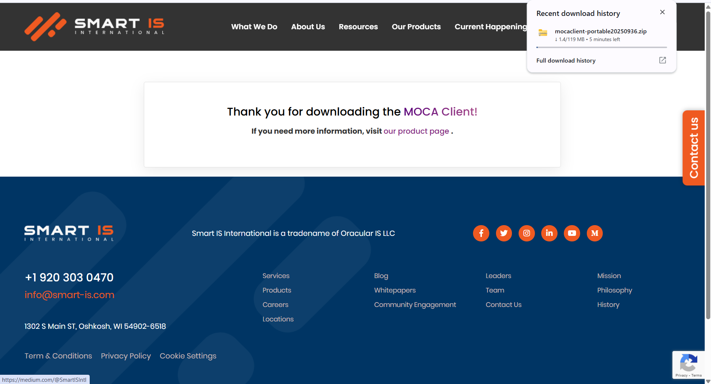

### Run the Portable

- Unzip the downloaded zip folder (mocaclient-portable<**version**>.zip) and open it.
   
  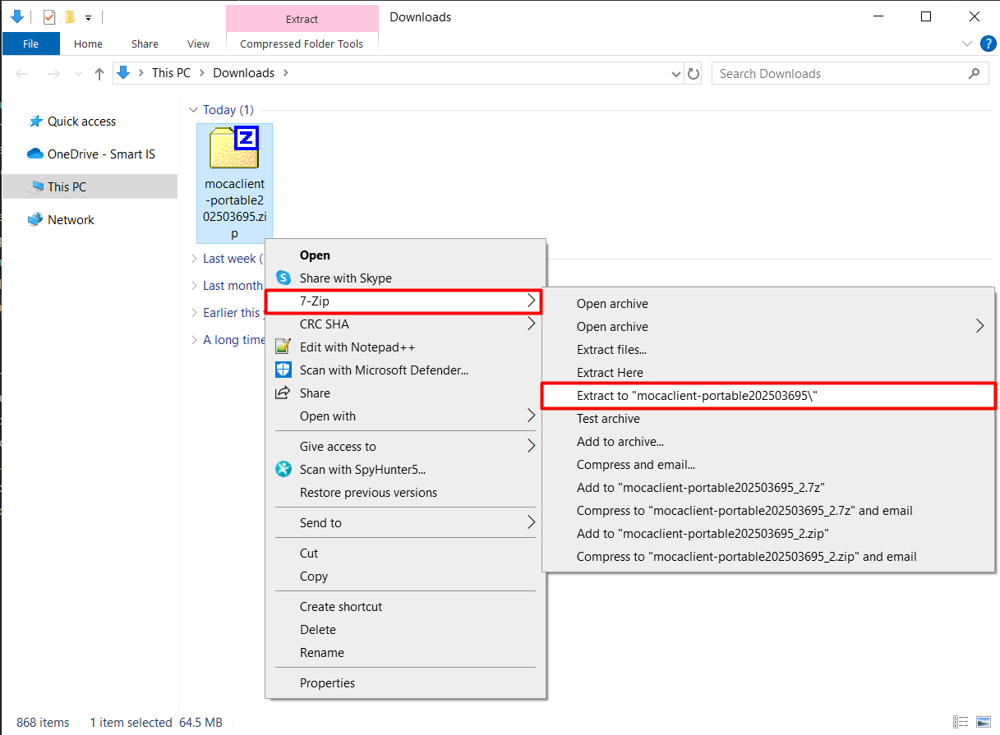

- Now double click on Run Setup and it will Download **Smart MOCA Client** using PowerShell.

  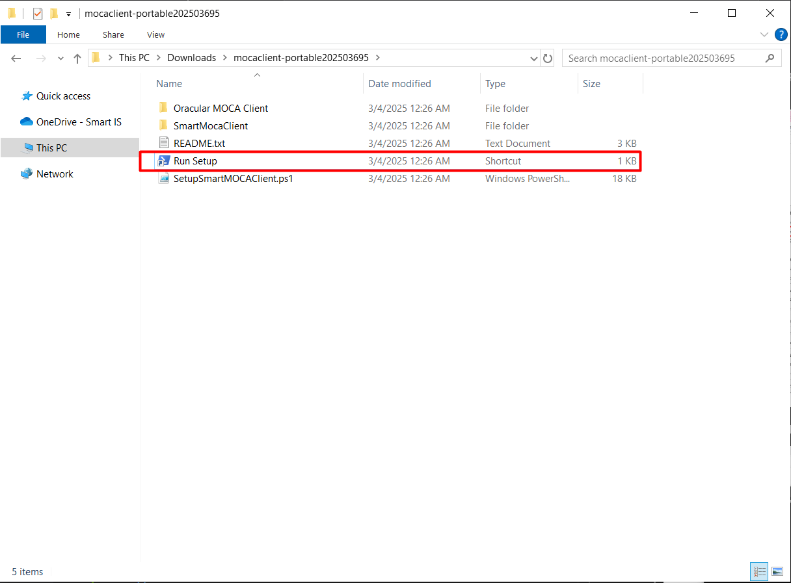
  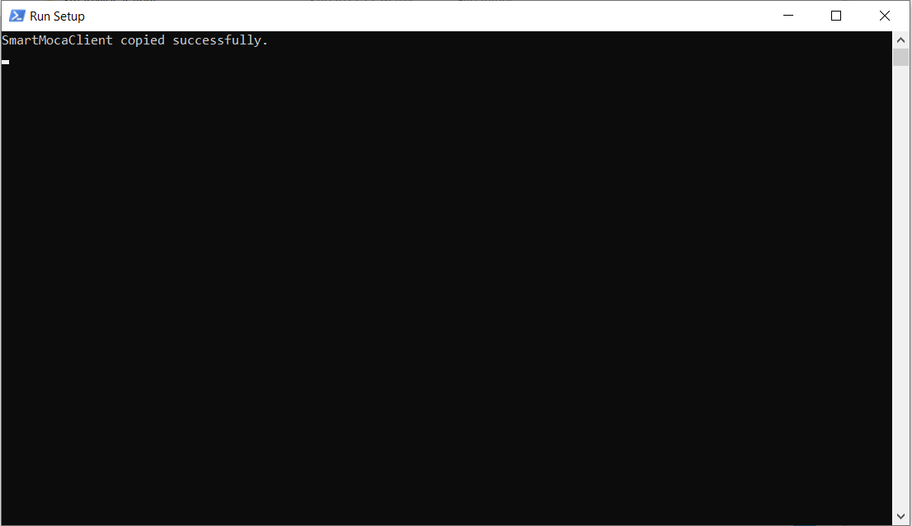

### Verify Portable Installation

Follow [Verify Installation](#verify-installation) to verify correct installation of Smart MOCA Client.

---

## MSI Installer
  
- On the download page, select **MSI Installer** and click on **Download** button.

  

- After clicking **"Download"**, the MSI setup will begin downloading.

  

- Follow [MSI Installation](./msi-installation.md) to install Smart MOCA Client with the MSI installer.
- Follow [MSI Uninstallation](./msi-uninstallation.md) to remove an MSI installation.

## Verify Installation

- The folder named `Oracular MOCA Client` and `SmartMOCAClient` should be created at the following path:

  
  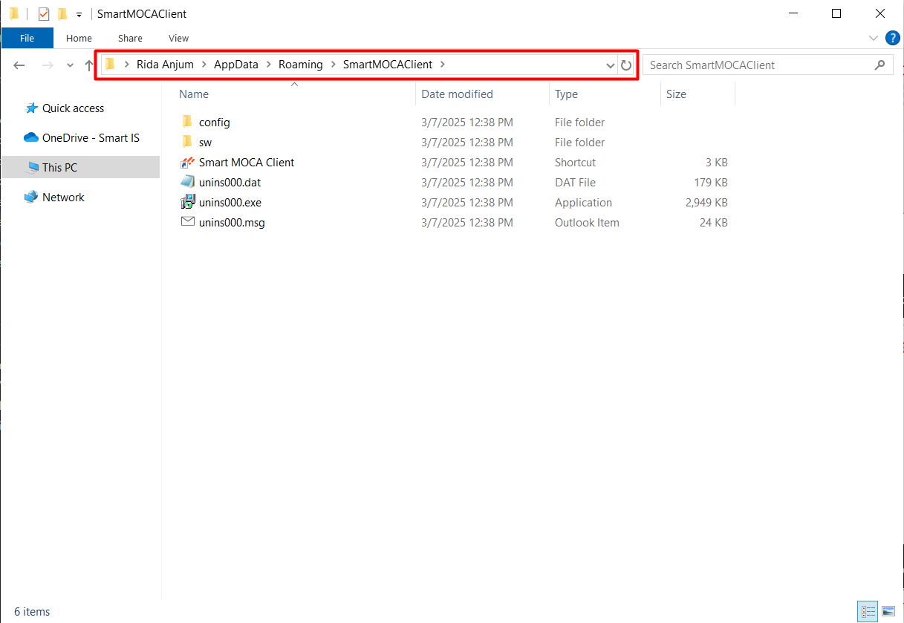

- Once installation is complete, you can verify it by checking the designated installation directory.

---

## Launch Smart MOCA Client
   
- Once installed, launch Smart MOCA Client by double-clicking on the desktop icon or searching for it in the start menu.

  

  <mark>**Note:** In case shortcuts are not created, the following shortcut can be used to launch Smart MOCA Client.</mark>

  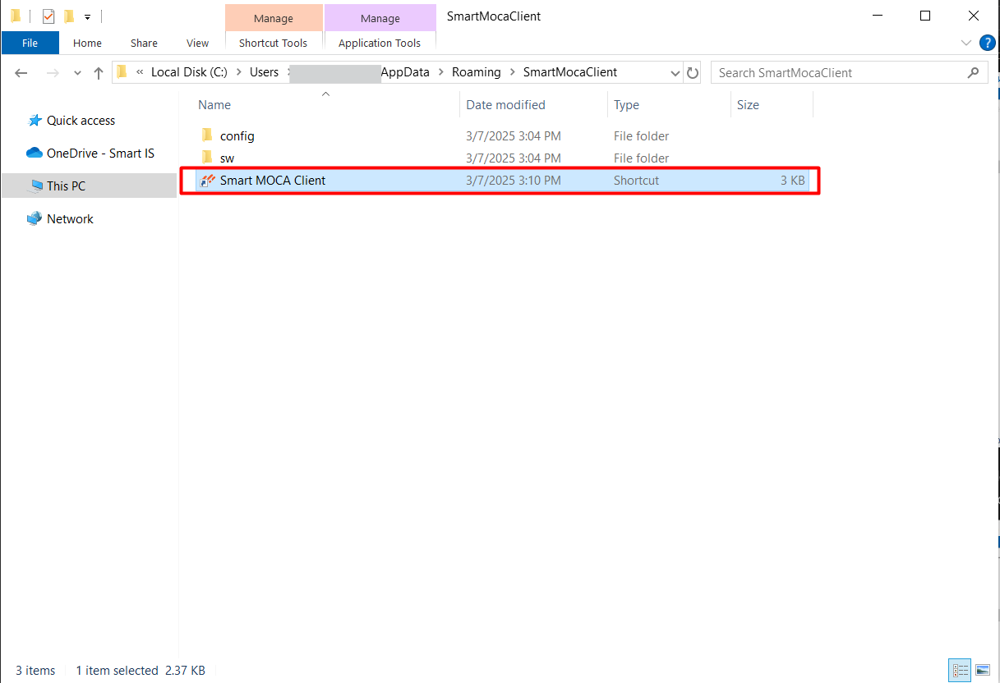

- Once the application starts, you will see the following interface:

  

Note: *Follow [Password Security](../connections/secure-server-connections.md) for details about the **Security** popup*.

## Add Server

Follow [Add/Update/Remove Server](../connections/add-connect-remoteserver.md) to add server in Smart MOCA Client.

## Download `moca.jar`

Following are the methods to download `moca.jar` in Smart MOCA Client:

1. Download upon Server Connection
2. Download via Tools Menu

### Download upon Server Connection

- Upon the first server connection, the Smart MOCA Client detects the absence of `moca.jar` and following popup appears:

  

- Click on the **Download and Use the `moca.jar` from this environment** button and the system will begin downloading the moca.pending_jar file .

  
  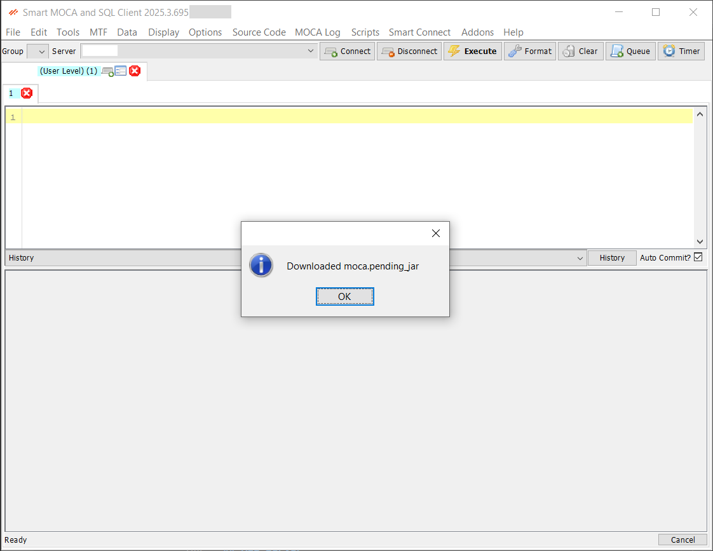

- Navigate to the directory and ensure that the **moca.pending_jar** file has been successfully downloaded.

  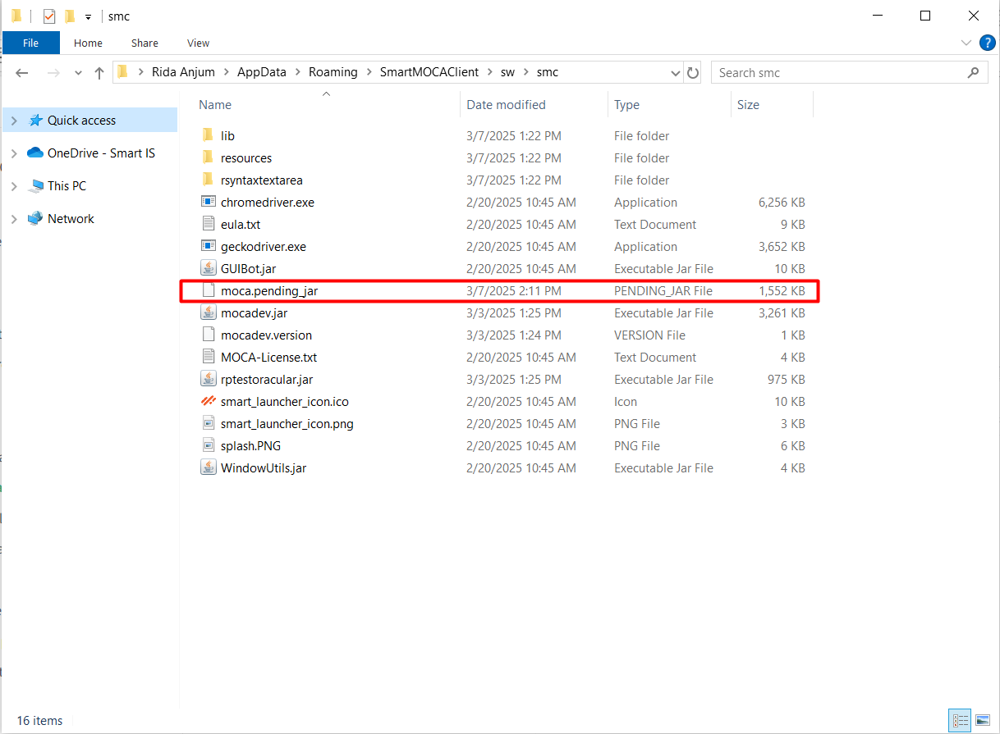

- Now click on **OK** button and **restart** Smart MOCA Client. The system will automatically rename **moca.pending_jar** to **moca.jar** and will use `moca.jar` instead of labelzoom.jar.

  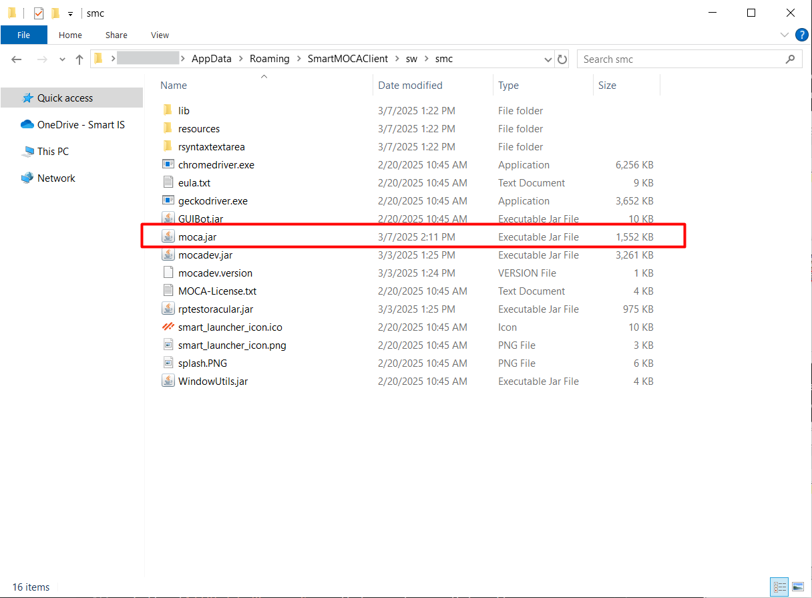

- Finally, verify the usage of `moca.jar` by navigating **Help --> About Smart MOCA and SQL Client**.

  

### Download via Tools Menu

- If you have skipped [Download upon Server Connection](#download-upon-server-connection), then you can download the `moca.jar` later by navigating to **Tools --> Download moca.jar**.

  

<mark>**Note:** *moca.jar should be compatible with current java version.*</mark>
