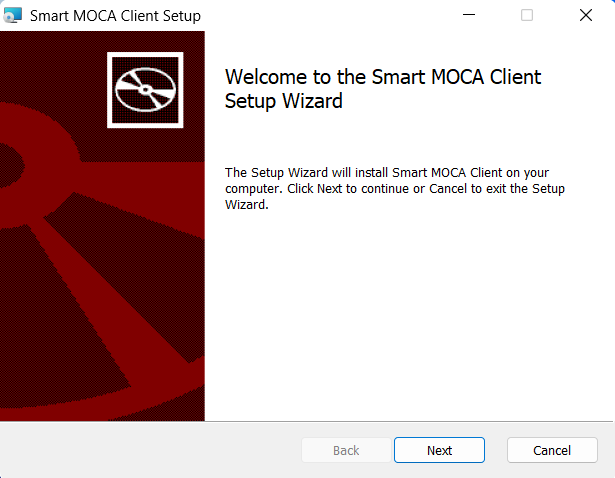
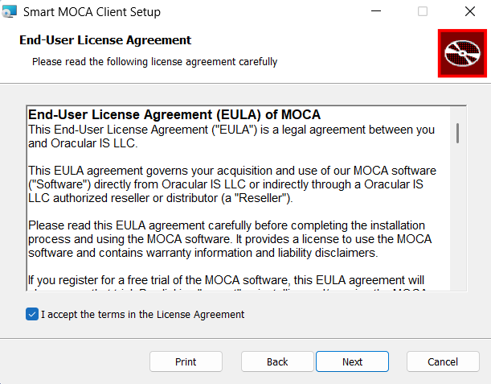
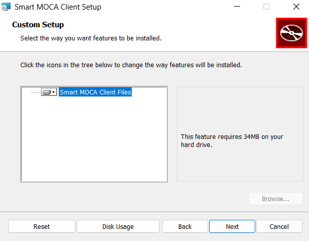
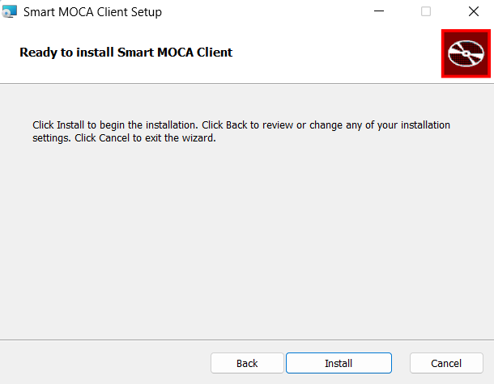
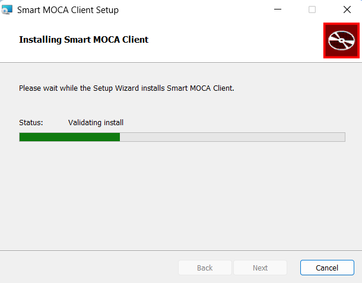
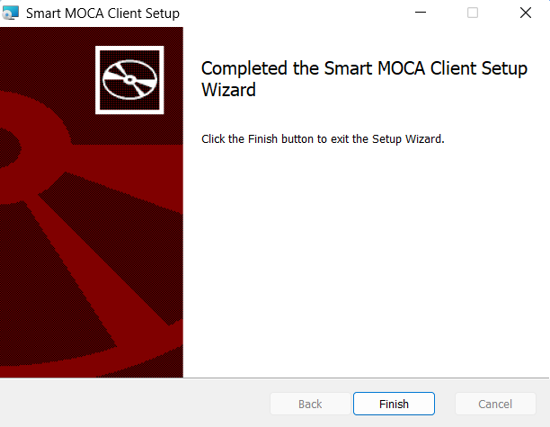

# Install with the MSI Installer

> **At a glance**
>
> | Item | Details |
> | --- | --- |
> | Applies to | MSI installer |
> | Administrator rights | Not needed for **Run as User**. Needed for **Run as Administrator**. |
> | Time needed | About 5 minutes |

Use this page for the normal interactive MSI installation. For unattended deployment, use [Silent install with MSI](/getting-started/msi-silent-installation.md).

## Before You Begin

- Download the MSI installer package.
- Close any running Smart MOCA Client windows.
- Choose the installation mode:
  - **Run as User (recommended):** installs for the current user only. No administrator privileges are needed.
  - **Run as Administrator:** installs for all users. Windows asks for administrator approval.

> **Note:** The MSI installer will not install again if Smart MOCA Client is already installed. It tells you at the start.

## Default Installation Folders

| Mode | Default folder |
| --- | --- |
| Run as User | `%APPDATA%\smartmocaclient` |
| Run as Administrator | `%PROGRAMDATA%\smartmocaclient` |

## Install Smart MOCA Client

1. On **Choose installation mode**, click **Next** to continue with **Run as User (current user only)** selected.

   **Run as User** installs Smart MOCA Client for the current user only and needs no administrator rights. **Run as Administrator** installs for all users and Windows will ask for administrator approval (UAC).

   

2. On **Welcome to the Smart MOCA Client Setup Wizard**, click **Next**.

   

3. On **End-User License Agreement**, click **Next** after **I accept the terms in the License Agreement** is selected.

   

4. On **Custom Setup**, click **Next** to install the Smart MOCA Client files.

   

5. On **Ready to install Smart MOCA Client**, click **Install**.

   

6. On **Installing Smart MOCA Client**, wait while the MSI installer installs Smart MOCA Client.

   

7. On **Completed the Smart MOCA Client Setup Wizard**, click **Finish**.

   

## What You Should See When It Worked

- Smart MOCA Client is installed in the selected installation folder.
- Smart MOCA Client shortcuts are available from the Start Menu or desktop.
- Smart MOCA Client opens from the shortcut.

## Common Problems

For installation issues, see [Troubleshooting](/getting-started/troubleshooting.md).

## Related Pages

- [Silent install with MSI](/getting-started/msi-silent-installation.md)
- [Uninstall MSI](/getting-started/msi-uninstallation.md)
- [Install with the EXE installer](/getting-started/exe-installation.md)
- [Troubleshooting](/getting-started/troubleshooting.md)

## Next Steps

After installation, return to [Current Version: Overview and Download](/getting-started/getting-started-current.md) to verify the installation, launch Smart MOCA Client, and add a server.
