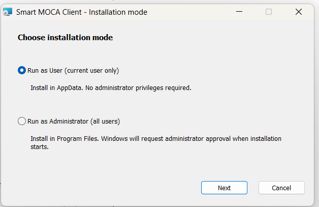

# MSI Installation

## Overview

Use the MSI installer when you need Windows Installer deployment, managed installation properties, or enterprise software distribution.

Do not install the MSI version over an EXE installation. Uninstall the EXE version first.

## Prerequisites

- Windows 7 or later.
- Java 8 or newer.
- The `mocaclient-setup.msi` installer.
- Administrator rights only when installing for all users.

## Installation

### Default Installation

```bat
msiexec.exe /i "mocaclient-setup.msi"
```

This opens the MSI wizard. The default mode is **Run as User**, which installs Smart MOCA Client for the current user.

### Custom Installation

To install for all users, select **Run as Administrator (all users)** in the wizard. Windows requests administrator approval when installation starts.



Use a custom installation directory only when you need Smart MOCA Client installed outside the default folder.

```bat
msiexec.exe /i "mocaclient-setup.msi" INSTALLDIR="D:\SmartMOCAClient"
```

### Silent Installation

```bat
msiexec.exe /i "mocaclient-setup.msi" /qn /norestart ACCEPT_EULA=1
```

This installs silently with the MSI defaults: current-user mode, automatic updates enabled, and the default current-user installation folder.

Install silently for all users:

```bat
msiexec.exe /i "mocaclient-setup.msi" /qn /norestart ALLUSERS=1 INSTALLMODE=Machine ACCEPT_EULA=1
```

Install silently with a custom folder:

```bat
msiexec.exe /i "mocaclient-setup.msi" /qn /norestart ACCEPT_EULA=1 INSTALLDIR="D:\SmartMOCAClient"
```

Install silently with a specific Java executable:

```bat
msiexec.exe /i "mocaclient-setup.msi" /qn /norestart ACCEPT_EULA=1 JAVA_PATH="C:\Program Files\Java\jdk-22\bin\javaw.exe"
```

Create a verbose installation log:

```bat
msiexec.exe /i "mocaclient-setup.msi" /qn /norestart ACCEPT_EULA=1 /L*V "%TEMP%\smc-msi-install.log"
```

## Installation Options

| Option | Default | Description |
| --- | --- | --- |
| `ALLUSERS` | `2` | Windows Installer installation context. With `MSIINSTALLPERUSER=1`, this selects current-user mode. Use `ALLUSERS=1` for all-users mode. |
| `MSIINSTALLPERUSER` | `1` | Enables per-user MSI installation. Use with `ALLUSERS=2` for current-user mode. |
| `INSTALLMODE` | `User` | Smart MOCA Client installation mode. Use `User` for current-user mode or `Machine` for all-users mode. |
| `INSTALLDIR` | `%APPDATA%\SmartMOCAClient` for current-user mode; `%PROGRAMDATA%\SmartMOCAClient` for all-users mode. A saved install path is reused when present. | Installation directory for Smart MOCA Client application files. |
| Oracular MOCA Client data folder | Resolved interactive user's `%APPDATA%\Oracular MOCA Client`. | Saved Smart MOCA Client data. This is not changed by `INSTALLDIR`. |
| Oracular Automated Testing data folder | Resolved interactive user's `%APPDATA%\Oracular Automated Testing`. | Automated testing data used by Smart MOCA Client. This is not changed by `INSTALLDIR`. |
| `ACCEPT_EULA` | Not set | Required for silent MSI installation. Use `ACCEPT_EULA=1`. |
| `AUTOUPDATE` | `YES` in current-user mode; `NO` in all-users mode. | Controls the generated Smart MOCA Client update check setting. Use `YES` or `NO`. |
| `JAVA_PATH` | Auto-detected Java 8 or newer `javaw.exe`; a saved value is reused when present. | Java executable used by installed shortcuts. The folder must also contain `java.exe`. |

## Examples

Current-user installation with explicit defaults:

```bat
msiexec.exe /i "mocaclient-setup.msi" /qn /norestart ALLUSERS=2 MSIINSTALLPERUSER=1 INSTALLMODE=User ACCEPT_EULA=1 AUTOUPDATE=YES
```

All-users installation with custom folder, Java path, and automatic updates disabled:

```bat
msiexec.exe /i "mocaclient-setup.msi" /qn /norestart ALLUSERS=1 INSTALLMODE=Machine ACCEPT_EULA=1 AUTOUPDATE=NO INSTALLDIR="D:\SmartMOCAClient" JAVA_PATH="C:\Program Files\Java\jdk-22\bin\javaw.exe"
```

## Related Pages

- [MSI Uninstallation](./getting-started/msi-uninstallation.md)
- [EXE Installation](./getting-started/exe-installation.md)
