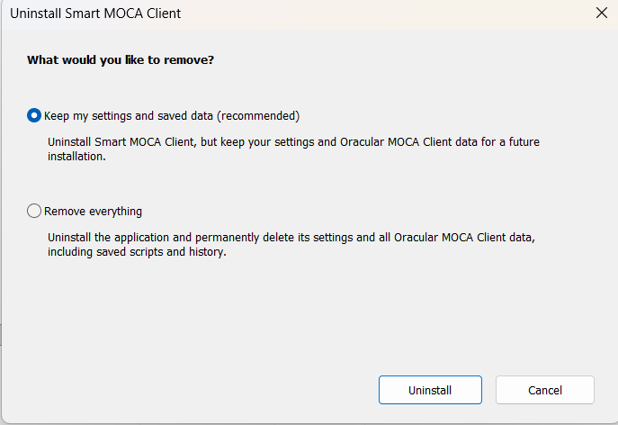

# Uninstall MSI

> **At a glance**
>
> | Item | Details |
> | --- | --- |
> | Applies to | Installations created by the MSI installer |
> | Administrator rights | Needed if Smart MOCA Client was installed with **Run as Administrator** |
> | Time needed | About 5 minutes |

Use this page only when Smart MOCA Client was installed with the MSI installer. If it was installed with EXE, use [Uninstall EXE](/getting-started/exe-uninstallation.md).

## Before You Begin

- Close Smart MOCA Client.
- Back up anything you cannot afford to lose.
- Decide whether to keep saved settings or remove everything.

> **Warning:** **Remove everything** permanently deletes settings and Oracular MOCA Client data, including saved scripts and history. This cannot be undone.

## Uninstall Smart MOCA Client

1. Open **Apps & features**, or run the MSI uninstall command with UI.
2. Choose one uninstall option:
   - **Keep my settings and saved data (recommended):** removes the application folder except the `config` folder and removes shortcuts. It does not touch the `Oracular MOCA Client` folder.
   - **Remove everything:** removes the application, settings, registry entries, and all Oracular MOCA Client data.

   

3. Select **Uninstall**.
4. Wait for the uninstall to finish.

## Uninstall Commands

Run silent MSI uninstall:

```bat
msiexec /x {2DC3A291-5F00-4794-8955-BF3E6F8A7956} /qn /l*v "%TEMP%\smc_uninstall.log"
```

Run MSI uninstall with full UI:

```bat
msiexec /x {2DC3A291-5F00-4794-8955-BF3E6F8A7956} /qf /norestart /l*v "%TEMP%\uninstall-full.log"
```

## What You Should See When It Worked

- Smart MOCA Client shortcuts are removed.
- The application files are removed.
- The uninstall log is created when you use one of the command-line options.

## Common Problems

For uninstall issues, see [Troubleshooting](/getting-started/troubleshooting.md).

## Related Pages

- [Install with the MSI installer](/getting-started/msi-installation.md)
- [Silent install with MSI](/getting-started/msi-silent-installation.md)
- [Uninstall EXE](/getting-started/exe-uninstallation.md)
- [Troubleshooting](/getting-started/troubleshooting.md)

## Next Steps

If you plan to reinstall, return to [Current Version: Overview and Download](/getting-started/getting-started-current.md).
