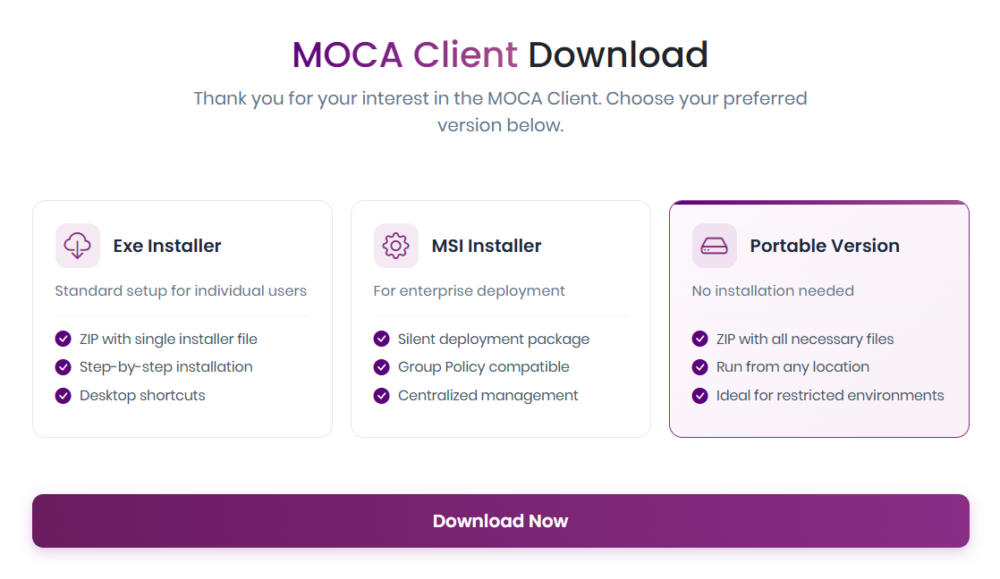
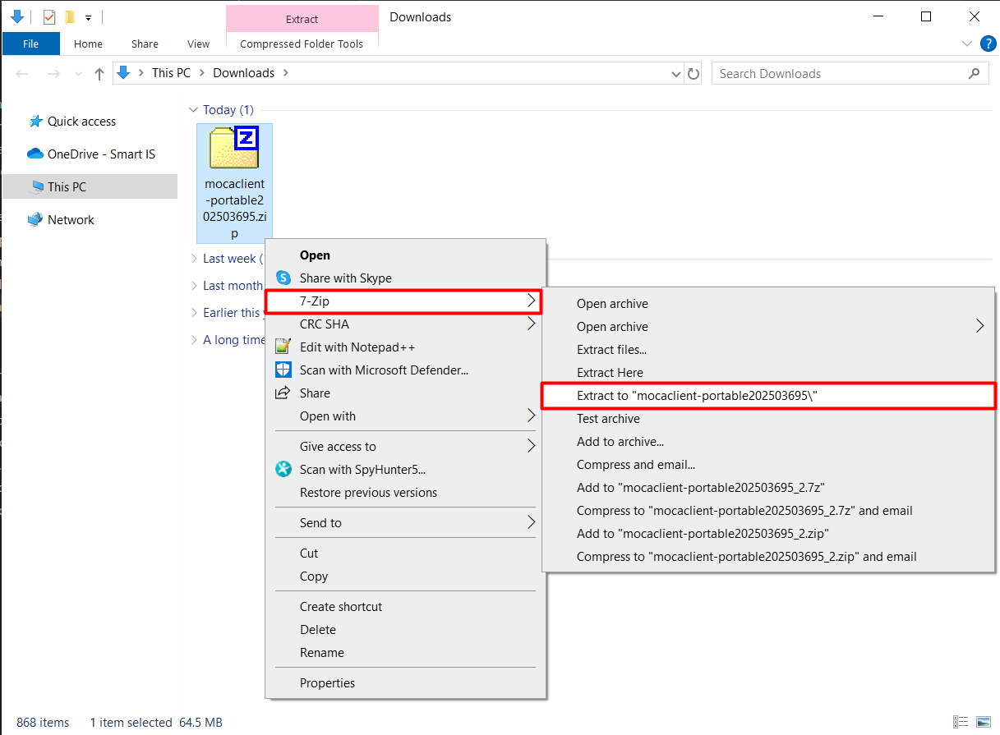
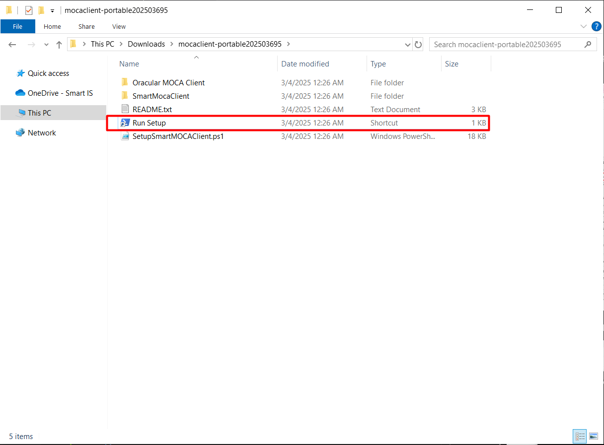

# Portable Setup

> **At a glance**
>
> | Item | Details |
> | --- | --- |
> | Applies to | Portable package |
> | Administrator rights | Depends on where files are extracted |
> | Time needed | About 5 minutes |

Use the portable package when you need to extract Smart MOCA Client without using the EXE or MSI installer.

## Before You Begin

- Download the portable package from the Smart MOCA Client download page.
- Choose a folder where you have permission to extract files.

## Set Up the Portable Package

1. On the download page, select **Portable**.
2. Select **Download**.

   

3. Extract the downloaded `mocaclient-portable<version>.zip` file.

   

4. Open the extracted folder.
5. Run the included setup launcher.

   

## What You Should See When It Worked

- The portable files are extracted.
- Smart MOCA Client starts from the extracted folder.

## Common Problems

For setup issues, see [Troubleshooting](/getting-started/troubleshooting.md).

## Related Pages

- [Current Version: Overview and Download](/getting-started/getting-started-current.md)
- [Install with the EXE installer](/getting-started/exe-installation.md)
- [Install with the MSI installer](/getting-started/msi-installation.md)
- [Troubleshooting](/getting-started/troubleshooting.md)

## Next Steps

After setup, return to [Current Version: Overview and Download](/getting-started/getting-started-current.md) to verify the setup, launch Smart MOCA Client, and add a server.
